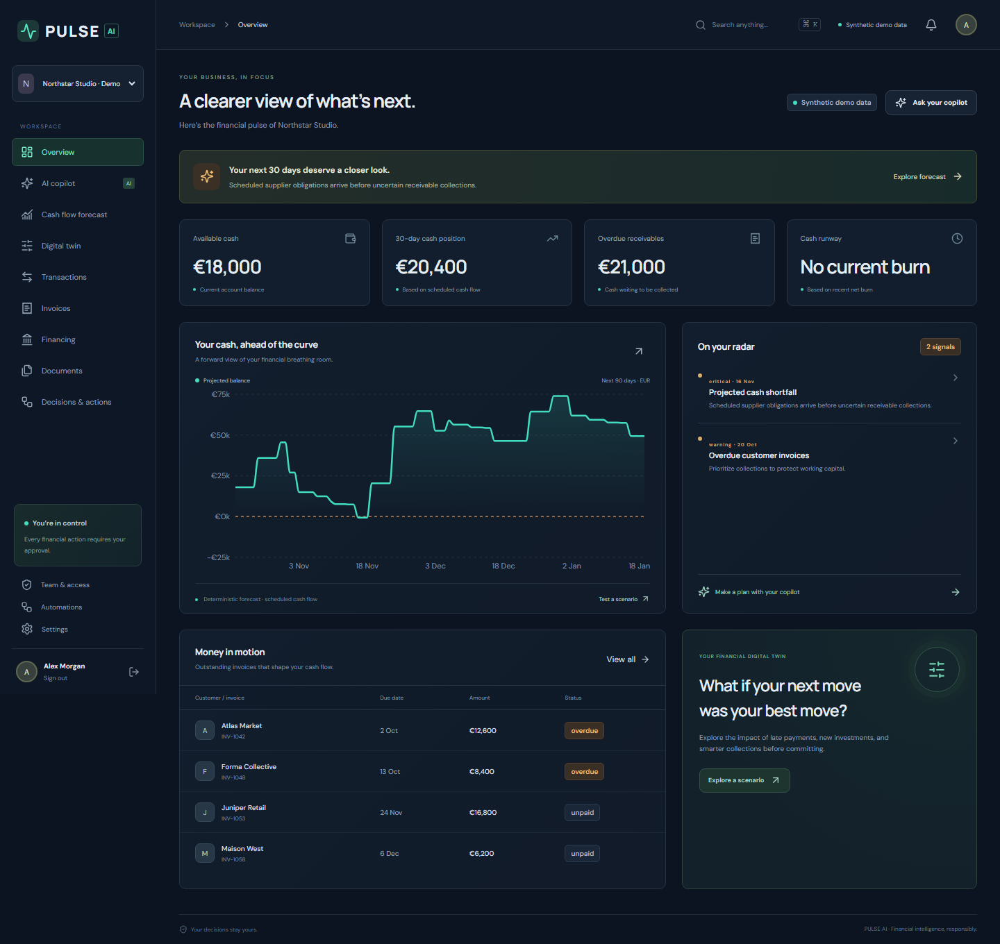
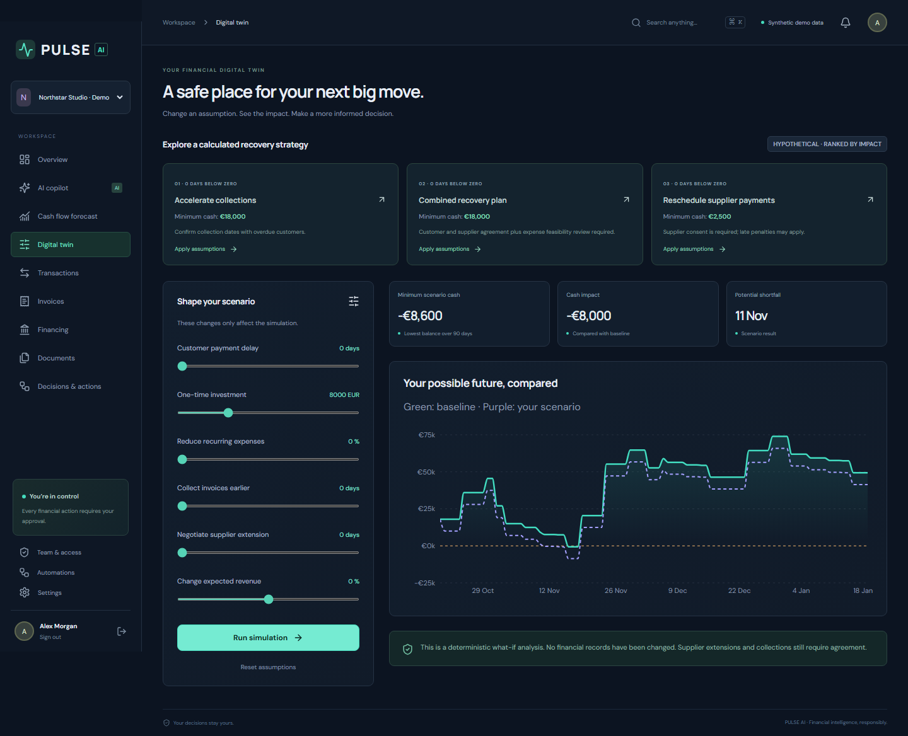

# PULSE AI

**Your business deserves a financial brain.**

PULSE is an SME finance copilot for the Shenzhen International FinTech Competition 2026, Topic E. It connects a financial command center, deterministic cash-flow forecasting, a Financial Digital Twin and human-reviewed invoice reminders. Northstar Studio is a synthetic demonstration company; no bank feed or live market data is claimed.

## Run locally

Requires Python 3.11+ and Node.js 22+. Developed with Python 3.13 and Node 24.

On Windows, from this directory:

```powershell
powershell -ExecutionPolicy Bypass -File scripts/start.ps1
```

Or install and start in two terminals:

```powershell
python -m venv .venv
.\.venv\Scripts\python.exe -m pip install -r backend/requirements.txt
cd backend
..\.venv\Scripts\python.exe -m uvicorn app.main:app --host 127.0.0.1 --port 8000
```

```powershell
cd frontend
npm.cmd ci
npm.cmd run dev -- --host 127.0.0.1
```

On macOS/Linux use `.venv/bin/python`, `npm`, and the equivalent directory commands. Open **http://localhost:5173**. API documentation: **http://localhost:8000/docs**. Choose **Explore the live demo** to create synthetic data. Ordinary registration starts a separate company. SQLite data persists in `backend/pulse.db`.

One-command seed: `python backend/scripts/seed.py` creates a fresh isolated synthetic organization in the database selected by `DATABASE_URL` (relative SQLite paths resolve from your current directory). The frontend demo button also creates a fresh authenticated demo session. It does not use a publicly shared password.

Docker alternative: `docker compose up --build`. Docker startup is provided but must be verified on a Docker-equipped machine.

## Configuration

The backend reads environment variables. `.env.example` documents the names; export them into your process environment before startup. A `.env` file is not automatically loaded unless your process runner loads it.

| Variable | Purpose |
| --- | --- |
| `DATABASE_URL` | SQLAlchemy connection URL; SQLite default, PostgreSQL driver included |
| `CORS_ORIGINS` | Comma-separated browser origins |
| `DEMO_ENABLED` | Development synthetic-company endpoint; disable in public deployment |
| `LLM_API_KEY`, `LLM_BASE_URL`, `LLM_MODEL` | Optional server-side compatible AI provider |
| `N8N_WEBHOOK_URL`, `N8N_WEBHOOK_SECRET` | Optional automation integration |

No credentials are needed for the local financial demo. Without AI configuration, the copilot explicitly returns deterministic financial explanations. Without delivery integration, reminders remain queued/offline. A queued reminder is not an email delivery confirmation.

## Verify

```powershell
cd backend
python -m pytest -q
```

```powershell
cd frontend
npm.cmd ci
npm.cmd run build
```

See [feature status](docs/FEATURE_STATUS.md) for checks actually executed and incomplete capabilities, [architecture](docs/ARCHITECTURE.md), [demo walkthrough](docs/DEMO_SCRIPT.md), and [competition summary](docs/COMPETITION_SUBMISSION.md).

With both services running, `python scripts/verify_demo.py` verifies the financial crisis and local approval flow against HTTP. Browser checks use `python scripts/browser_smoke.py` after installing Playwright (`python -m pip install playwright` and `python -m playwright install chromium`). The browser check creates a fresh demo and saves screenshots. It requires an unconfigured local delivery queue and does not dispatch email.

The generated [OpenAPI contract](docs/openapi.json) documents request and response schemas. For database schema setup, `cd backend` then `python -m alembic upgrade head`; development startup also creates missing tables. Back up an existing database before applying future migrations.

## Financial method and safety

Python Decimal arithmetic computes balances from persisted records. Forecasts use dated outstanding invoices and explicitly disclosed recurrence assumptions. Overdue receivables are uncertain future collections. Simulations alter assumptions without editing source transactions. They are decision support, not guarantees or regulated financial advice.

Opaque expiring sessions, organization-scoped membership checks and mutation permissions protect API access. Consequential actions require approval and produce audit records. No funds transfer, borrowing, trading or bank connection is implemented. This prototype needs a deployment security review, HTTPS, production secret management and operational hardening before public financial use.

## Stack

React, TypeScript, Vite, Recharts, Lucide, React Router, TanStack Query, Motion, React Hook Form and Zod; Python, FastAPI, Pydantic and SQLAlchemy. The implementation favors a working modular monolith over distributed infrastructure. Optional integrations and advanced wishlist items are listed honestly in the feature-status document.

## Screenshots




